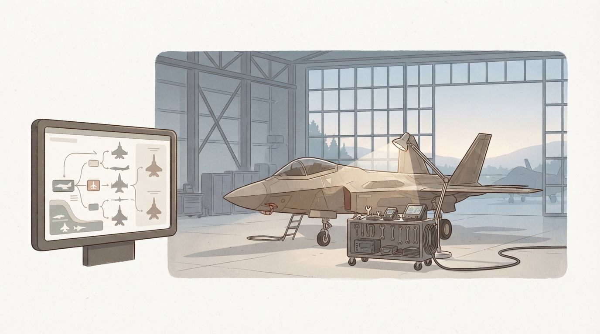
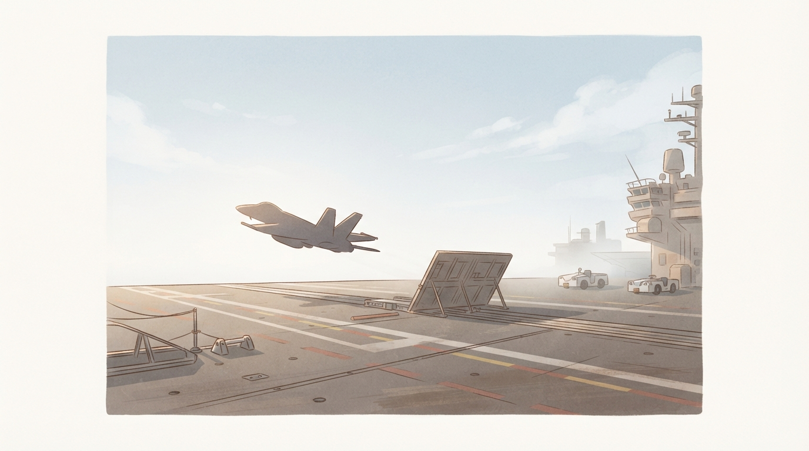
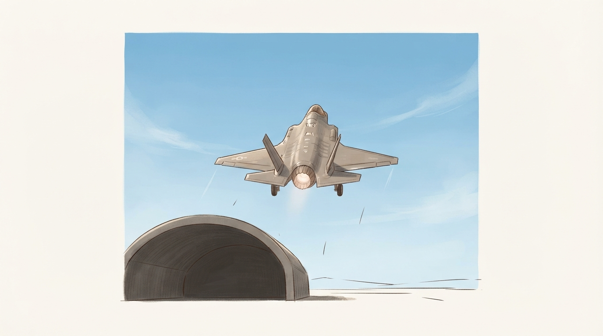

工場や製造ラインの立ち上げにおいて、最もやってはならない失敗があります。それは「手元の運転資金が足りない段階で、カタログの見栄えが良い最新設備をあちこち買い揃えてしまうこと」です。その結果、肝心の治具や保全パーツを買う予算が尽き、生産ラインそのものが止まってしまいます。

『ACE COMBAT 8: WINGS OF THEVE』の機体ツリーとMRP（軍事予算）経済システムを初めて目にしたとき、私はまったく同じ構図を感じました。

多くのパイロットが、ゲーム序盤から中盤にかけて「資金不足で新しい機体が買えない」「難所を突破できない」という壁にぶつかります。しかし、これは操縦技術（ドッグファイトの腕前）の問題ではありません。その手前にある「資源配分と設備投資の設計ミス」が原因です。

限られたMRPをどこに集中させ、どの機体をどの順番で解放すべきか。本記事では、根性論や感覚的な好みを一切排し、最短距離で終盤の万能機「F-35C」まで駆け抜けるための再現性ある機体ツリー進行戦略を論理的に解説します。

---

## 1. カタログの罠と「隠れコスト」——なぜ多くのパイロットが金欠で詰むのか

本作のキャンペーンモード（全30ミッション）を標準難易度で進める際、手に入るMRPには明確な限界があります。初期段階から中盤にかけて自由に使える資金は、決して潤沢ではありません。ここで初心者が最も陥りやすいのが「広く浅い買い広げ」です。

### 表示価格の倍近くに達する「必須通過コスト」

AIRCRAFT TREEの画面を開くと、魅力的な機体とその購入価格が並んでいます。たとえば中盤の主力機であるF/A-18Eは240,000 MRP、終盤の第5世代機であるF-35CやF-22Aは550,000 MRPと表示されています。

これを見て「55万MRP貯まれば最高峰のステルス戦闘機に乗れる」と考えてしまうのが最初の罠です。

本作の機体ツリーは、機体アイコンへ直行できる構造にはなっていません。機体と機体のあいだには、複数の強化パーツノードや兵装ノードが配置されており、それらをすべて購入して導線を繋げなければ、目標の機体を購入する権利すら得られません。

具体例として、初期機体からF-35Cへ到達するまでのノード構成を見てみましょう。本体価格は550,000 MRPですが、そこに至るまでに経由しなければならない必須パーツや中継機体の費用を合算すると、累計で1,495,000 MRP（約150万MRP）に達します。機体単体の表示価格の2.7倍近い予算が実際に必要となる計算です。

さらに、機体購入後に追加の特殊兵装（HCAAや8AGMなど）を解放しようとすれば、1枠あたり55,000 MRPの追加投資が発生します。この「見えないインフラ投資」を計算に入れずに機体ツリーを眺めていると、目標の機体に到達するはるか手前で資金が底をつき、身動きが取れなくなります。

### 枝分かれに手を出す「MRP溶かし」の恐怖

もうひとつの致命的な失敗パターンは、目移りによる浮気買いです。

空戦用にかっこいいF-14D（90,000 MRP）を買い、対地攻撃が難しそうだからとA-10C（180,000 MRP）を買い、自衛隊機が好きだからとF-2A（130,000 MRP）の枝にも手を伸ばす。このように複数のツリー枝に少額ずつ投資してしまうと、手持ちのMRPは瞬く間に蒸発します。

結果として手元に残るのは、中盤以降の敵機動性やミッション難易度についていけない「型落ち機体のコレクション」だけです。製造業で例えるなら、半端な汎用工作機械を何台も買い集めたせいで、主力の高精度マシニングセンタを導入できず納期遅れを起こすようなものです。

1周目のキャンペーン攻略において最も重要な鉄則は「目的の最終機体まで、寄り道を一切せずに一本の直線ルートで突き抜けること」です。

---

## 2. 出撃不能を防ぐ絶対条件——見落としてはならない「空母発着艦能力」の罠

機体選びにおいて、初心者が最も深刻なショックを受ける仕様があります。それが「空母発着艦能力」の有無による出撃制限です。

### 陸上機を選んだ代償としての「強制留守番」

本作のストーリーでは、移動式の巨大航空基地である空母「エンデュランス」を拠点とした作戦が数多く展開されます。全長約333メートルの空母甲板は、陸上の航空基地と比べて極めて短く、カタパルトによる射出装置と、着艦時に機体を強制停止させるアレスティングフックに対応した構造を持っていなければ物理的に運用できません。

この現実のミリタリー仕様が、ゲーム内でも厳格なシステム制約として適用されています。つまり、空母からスタートするミッションでは、艦載機適性を持たない陸上機は「出撃不可（グレーアウト）」となり、選択肢から完全に除外されます。

知名度と圧倒的な空戦性能に惹かれ、なけなしの資金をかき集めてF-22A Raptor（陸上機）を苦労して購入した初心者が、次の空母ミッションで出撃できず、初期機体で出撃せざるを得なくなるという悲劇が後を絶ちません。

### アイコン左上の「錨マーク」を常に確認せよ

ツリー画面で機体を選択する際、真っ先に確認すべきは基本ステータス（最高速度や旋回性）のグラフではありません。機体アイコンの左上に表示されている「白い錨（いかり）マーク」の有無です。

錨マークが刻まれている機体は、空母と陸上基地の双対運用が可能な「艦載機」です。艦載機を主力に据えていれば、キャンペーン内の全30ミッションにおいて「出撃できない」という事態は100パーセント発生しません。

序盤から終盤まで単一の投資ラインを無駄なく使い倒すためには、最初から最後まで「艦載機ツリー」の上を歩き続けることが、リスク管理上の絶対条件となります。

---

## 3. 機体の4大ロールと現場の選定基準——万能機が最強の選択肢になる理由

本作に登場する機体は、大きく分けて4つの役割（ロール）に分類されています。出撃準備画面ではアイコンの色で視覚的に識別できるよう設計されています。それぞれの特性と、現場での実用性を整理します。

### 4つのロールの特性と評価

ひとつ目は、水色アイコンで表示される「戦闘機（Fighter）」です。
最高速度、加速力、旋回性能に優れ、敵航空機の撃墜や制空権の確保に特化しています。対空戦闘では無類の強さを誇りますが、対地兵装の選択肢が極めて限られており、地上施設や艦船が主目標となるミッションでは手詰まりになりやすいのが難点です。

ふたつ目は、赤色アイコンで表示される「攻撃機（Attacker）」です。
地上目標や海上目標の掃討に特化した重武装・高耐久の機体です。大量の爆弾や長距離対地ミサイルを搭載できますが、最高速度が遅く、空中戦の運動性能が劣悪です。本作の広大な作戦空域を制限時間内に飛び回るミッションや、敵戦闘機の増援が乱入してくる複合任務では、足の遅さが命取りになります。さらに艦載機適性を持つ攻撃機が非常に限られている点も逆風です。

みっつ目は、緑色アイコンで表示される「電子戦機（Electronic Warfare）」です。
ECMやIEWSによる敵レーダー・ミサイル誘導の妨害、あるいは味方部隊の探知・誘導能力を底上げする支援機です。僚機として編隊に組み込むと強烈なシナジーを発揮しますが、単機での打撃力には欠けるため、プレイヤー自身の主力機として1周目を進めるには癖が強すぎます。

そしてよっつ目が、紫色アイコンで表示される「多目的機（Multirole）」です。
空対空、空対地、対艦のあらゆる目標に対して柔軟に対応できる万能機です。最高速度や格闘戦性能も高水準でまとまっており、挙動に不自然な癖がありません。

### 初見攻略におけるマルチロールの絶対的優位性

初見のキャンペーン攻略において、なぜマルチロール機が最強の選択肢となるのか。それは「作戦途中の状況変化」に耐えられる唯一のカテゴリーだからです。

本作のミッションの多くは、「地上基地の破壊」からスタートしたにもかかわらず、一定スコアを達成した瞬間に「敵の新型高機動戦闘機部隊が急襲してくる」といった2段構えの作戦設計がなされています。

ここで対地特化の攻撃機に乗っていた場合、突如現れた戦闘機部隊とのドッグファイトを鈍重な機体で生き残らなければならず、極めて高い難易度を強いられます。逆に純粋な戦闘機では、前半の地上施設を通常ミサイルと機銃だけでチマチマ削る羽目になり、時間切れのリスクを抱えます。

対空と対地の両方に高水準で対応でき、かつ空母発艦にも対応したマルチロール機こそが、無駄なリトライと投資のブレをゼロにする唯一の解なのです。

---

## 4. 最短でF-35Cへ到達する投資ルート——149万MRPの配分設計

ここからは、実際に初心者が進むべき「最短・最効率の機体ツリー開放ルート」を具体的に解説します。総コスト約1,495,000 MRPをどのように段階投入していくか、その工程設計です。

### ステップ1：初期機F/A-18Cの徹底延命と「運動性パーツ」の先行取得

ゲーム開始時、プレイヤーには無償で「F/A-18C Hornet」が配備されます。この機体は初期配布でありながら、マルチロール機であり、かつ空母発艦能力を備えた極めて優秀なプラットフォームです。

初心者が真っ先にやりがちなミスは、ミッション2〜3をクリアして手に入った数万MRPで、性能差のほとんどない低ランク機体を買い替えてしまうことです。これは投資として最悪の手です。

初期段階（Mission 01〜08付近）は、機体を一切買い替えてはいけません。資金はすべて、ツリーの最初の枝に配置されている「機動性向上パーツ」の取得に充当します。

優先すべきは以下の3点です。
まず、ロール速度を引き上げる「エルロン用補助加圧装置（ROLL+ / 7,500 MRP）」。
次に、加速性能を強化する「軽量型ブレードディスク（ACCEL+ / 7,500 MRP）」。
そして、ピッチ旋回性能を高める「フラップ用補助加圧装置（PITCH+ / 10,000 MRP）」。

わずか25,000 MRPのパーツ投資を行うだけで、初期機体F/A-18Cの旋回性と追従性は劇的に改善されます。下手な低ランク機体を10万MRP出して買うよりも、足回りを強化したF/A-18Cのほうが圧倒的に扱いやすく、実質的な戦闘力は上回ります。さらに、これらのパーツは将来購入する上位機体にもそのまま使い回せるため、減価償却の観点からも資産価値を失いません。

### ステップ2：中盤の要「F/A-18E Super Hornet」の卓越したスロット効率

初期機体と強化パーツで資金を温存しながら進み、Mission 09〜10前後に到達した段階で、初めて機体の乗り換えを行います。目指すべきは中盤の主力艦載機「F/A-18E Super Hornet（単座型 / 240,000 MRP）」です。

なお、同ランクには複座型のF/A-18Fも存在しますが、初心者は迷わず単座型の「E型」を選んでください。

F/A-18Eを推奨する決定的な理由は、以下の3点にあります。
第一に、特殊兵装として対空誘導に優れた「QAAM」と、密集した地上目標を一直線に更地にするスタンドオフ兵器「SOD」を搭載できる点です。
第二に、空母発艦能力（錨マーク）を標準装備している点です。
そして第三に、機体強化パーツ（BODYスロット）の搭載可能数が「6枠」と極めて多い点です。

機体の基本スペックそのものよりも、「どれだけ多くの強化パーツを同時に装着できるか」のほうが、実際のミッション攻略難易度を大きく左右します。序盤に購入した機動性パーツをフル装備したF/A-18Eは、中盤の激戦区を単機で制圧するのに十分すぎるパフォーマンスを発揮します。

### ステップ3：EA-18Gを経由し、終盤の決定打「F-35C」へ直進する

F/A-18Eを配備した後は、いよいよ最終目的地である第5世代ステルス万能艦載機「F-35C Lightning II（550,000 MRP）」へ向けて直進します。

途中、電子戦機である「EA-18G Growler（350,000 MRP）」と周辺の誘導パーツ・対ステルスレーダーノードを経由する必要があります。一見すると高額な中継点に見えますが、EA-18Gが持つ支援システム「ESM」は味方部隊の戦闘力を大幅に底上げするため、後述する僚機運用においても無駄になりません。

そしてMission 20付近でF-35Cを手に入れた瞬間、本作の攻略難易度は劇的に低下します。

F-35Cの最大の強みは、超長距離対地巡航ミサイル「LACM」を運用できる点です。敵の防空対空ミサイル（SAM）や対空砲火の射程外、はるか遠方の安全圏からボタンひとつで敵基地や艦隊の中枢を壊滅させることができます。

加えて、優れたステルス性能によって敵ミサイルの探知・被ロックオン率を大幅に低下させ、装弾数とリロード速度に優れた対空ミサイル「HCAA」によって空中戦の継戦能力も確保されます。

空母からの出撃に対応し、防空圏外からのアウトレンジ破壊が可能で、ステルスと空戦能力を兼ね備える。この単一プラットフォームに投資を集中させることが、本作における最も確実な「勝利の方程式」です。

---

## 5. 弾切れと僚機運用の落とし穴——特殊兵装2種搭載のトレードオフ

機体とルートの設計が整った後、実際の作戦運用において初心者が必ず直面する「落とし穴」についても触れておきます。ここを誤解していると、いくら良い機体に乗っていても任務失敗を招きます。

### 「特殊兵装2種搭載」に潜む弾数減少の罠

ストーリー中盤を過ぎると、特殊兵装をスロットに「2種類同時に搭載して出撃できるシステム」が解禁されます。

対空ミサイルと対地爆弾を両方持ち込めるため、一見すると「完全無欠の強化」に思えます。しかし、ここには重要なトレードオフが設計されています。

2種類の特殊兵装を同時に搭載した場合、1種類だけを特化搭載したときと比べて、それぞれの所持弾数が大幅に減少します。

例えば、長丁場の混成ミッションにおいて安易に両持ちを選択すると、前半の小競り合いで対地兵装を使い果たし、後半の主目標が現れたときには肝心の弾が残っていない、という事態が頻発します。

ミッションブリーフィングを確認し、主目標の比率が「対地7割・対空3割」のように偏っている場合は、あえて特殊兵装を1種類（LACM等）に絞り込んで最大弾数を持ち込み、対空戦闘は通常ミサイルの性能強化パーツで補う、という割り切りが有効です。なんでもできる装備構成は、現場では「器用貧乏な弾切れ」を招くリスクと隣り合わせであることを認識してください。

### 僚機への機体購入は「自機お下がり」で十分

もうひとつの資金管理の罠が、僚機（Joker隊）への機体投資です。

本作では、自分が解放した機体について、初回購入価格の「8分の1（12.5%）」という大幅な割引価格で僚機用に追加購入できる魅力的なシステムが用意されています。

これを見て「味方にもF/A-18Eを買い揃えてやろう」と序盤から資金を投じてしまうプレイヤーがいますが、これは明確な浪費です。

本作の僚機AIは、型落ちの機体（自分がかつて使っていたF/A-18CやF-16C）に乗せておいても、命令（援護や分散攻撃）を出せば十分に囮や露払いとしての役割を果たします。さらに、せっかく僚機用に高額な機体を買い足しても、自機と全く同じ特殊兵装を装備して追従してくれるとは限らず、勝手に爆弾を抱えて出撃してしまう仕様上のズレも存在します。

僚機のためにMRPを割くのは、自機のF-35C購入が完了し、必要な兵装とパーツがすべて揃った最終盤だけで構いません。それまでは、自分が使い古したお下がり機体をあてがっておくのが、資金運用のセオリーです。

---

## 6. 結論——自由は「操縦技術」ではなく「事前設計」で手に入れる

ドッグファイトで敵の背後を華麗に取り、渓谷をギリギリですり抜ける操縦技術は、フライトシューティングゲームの醍醐味です。しかし、そうした個人の操縦技術（職人芸）だけで厳しい戦局を覆そうとするのは、極めて疲弊しやすいプレイスタイルです。

製造現場において、品質のばらつきを現場作業員の「気合い」や「丁寧さ」に頼る工場は長続きしません。誰が作業しても同じ品質で不良品を出さないよう、事前の治具設計と工程管理で歩留まりを担保するのがプロフェッショナルの仕事です。

『エースコンバット8』の攻略もまったく同じです。

- 序盤は新機体の購入を我慢し、使い回しの利く運動性パーツに少額投資する
- 空母発艦制限（錨マーク）を常に確認し、艦載機の単一ラインを維持する
- 寄り道を完全遮断し、F/A-18CからF/A-18E、そしてF-35Cへと一直線に投資を集中させる
- 僚機への過剰投資を避け、特殊兵装の弾数管理を徹底する

この設計図に沿ってリソースを淡々と配分していけば、過剰なリトライや金欠に悩まされることなく、誰でも確実に最終局面までクリアできる再現性が手に入ります。

限られた軍事予算という制約条件の中で、いかに無駄を削ぎ落とし、最短で最強の布陣を敷くか。ぜひ「システムエンジニアの視点」で機体ツリーを眺め、合理的な空の戦いを設計してみてください。