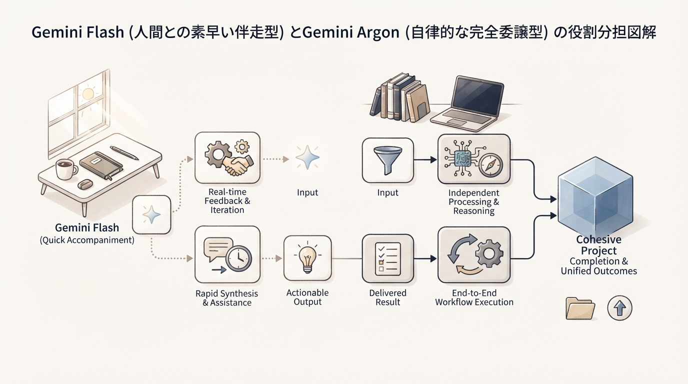
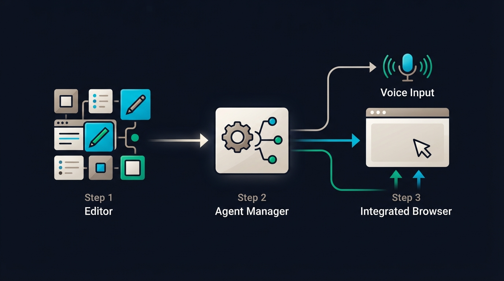
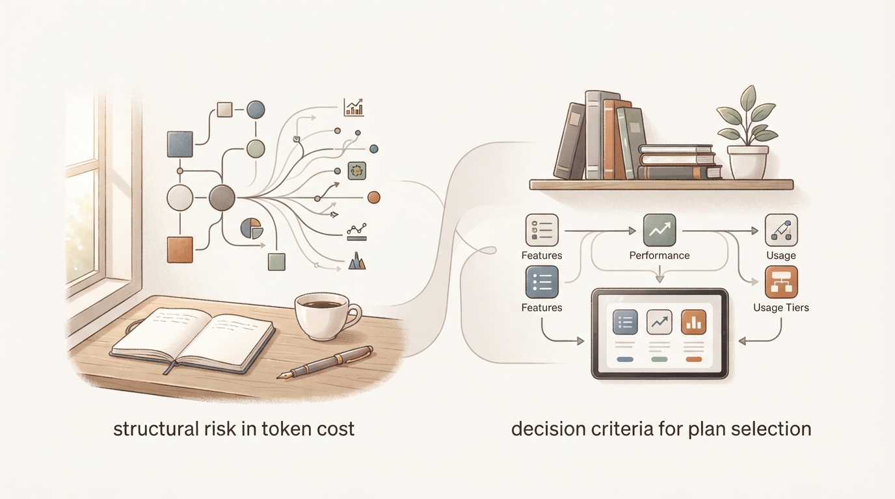

こんにちは、ケンジです。

普段は地方の製造業で25年間培った工程管理や業務標準化の経験をもとに、個人や小さな組織向けにAIを活用した仕組みづくりのお手伝いをしています。現在はマレーシアを生活拠点にしながら、どうすれば人間が余計なストレスを抱えずに、静かに心地よく日常を回せるかという「生活と仕事の設計」を探求しています。

突然ですが、皆さんは普段AIツールを使っていて、こんな疲れを感じたことはないでしょうか。

「プロンプトに細かく条件を書き並べないと、思っていたのと違う答えが返ってくる」
「ちょっとした手違いで止まってしまうので、画面の前でじっと見張っていないといけない」
「便利な連携ツール（MCPなど）をたくさん繋いだら、かえって設定が複雑になってエラーばかり出るようになった」

これらは、かつての私自身がまさに直面していた悩みでした。製造現場でいうところの「新人に作業を教えるとき、ネジの締め方から工具の置き場所まで1秒ごとに口を出し続けて、教える側がヘトヘトになってしまう状態（マイクロマネジメント）」と同じです。せっかく業務を楽にするために導入したはずなのに、これでは本末転倒ですよね。

しかし、2026年秋、この開発と自動化の現場に極めて大きな潮目の変化が訪れました。Googleが公開した新しい開発環境「Google Antigravity」の最新アップデートと、その心臓部となる最高峰モデル「Gemini 4 Argon」です。

開発チームの責任者であるKevin氏がライブ配信で語ったメッセージは非常にシンプルかつ衝撃的でした。
「ここ数年で得た最大の教訓は、『モデルの邪魔をするな（Don't get in the way of the model）』という点に尽きる」

AIの能力が一定の閾値を超えたことで、人間が先回りして細かなレール（過剰なツールや厳密な指示）を敷くよりも、信頼できる道具を与えて「最終ゴール」だけを委ねるほうが、圧倒的に早くて確実な成果が出る時代に入ったのです。

本記事では、このGoogle AntigravityとGemini 4 Argonがもたらす新しいパラダイムについて、難しい専門用語をできる限り日常の身近な比喩に置き換えながら、現場のリアルな注意点（Gotchas）やコストの落とし穴まで包み隠さず丁寧に解説します。

焦る必要はありません。お気に入りのコーヒーでも飲みながら、ゆっくりとこれからの仕事の設計図を一緒に覗いてみましょう。

---

## 1. 「モデルの邪魔をしない」という新哲学――なぜ細かすぎる指示や複雑な連携が逆効果になるのか

### なぜそれをやるのか（目的とメリット）

現場で作業効率を高めようとするとき、真面目な人ほど「失敗させないための厳格なマニュアル」を作り込んでしまいがちです。

これまでのAI活用でも同じことが起きていました。AIが変な挙動をしないように、何十行もの制約条件をプロンプトに詰め込み、ファイル操作や検索のために専用の連携プラグイン（いわゆるMCP：Model Context Protocolなど）を何重にもセットアップする。いわば「ベテラン職人が新人の手首を掴んで一緒に動かしている」ような状態です。

しかし、モデル自体の推論力や安全性が飛躍的に向上した現在、その過剰なガードレール自体が、AIの視野を狭め、動作を重くし、予期せぬエラーを引き起こすボトルネックになり始めています。

Google Antigravityの開発チームが打ち出した「モデルの邪魔をしない」という哲学は、人間が手取り足取り指図するのをやめ、AIに直接ターミナル（パソコンの基本的な命令画面）やスクリプトを操作させるという考え方です。

この転換によって得られるメリットは極めて明快です。
・指示文（プロンプト）の作成時間が大幅に削減される（数行の大まかなゴール設定で済む）
・専用ツールの設定やバージョン不整合によるイライラから解放される
・AI自身が現場の状況を見ながら、自律的に最適なコマンドやPythonスクリプトを組み立てて解決してくれる

### ステップ・バイ・ステップ手順（1・2・3）

では、具体的にどのようにして「モデルの邪魔をしない」アプローチへシフトしていくのか、3つのステップで整理してみましょう。

1. **「薄い中間ツール」を思い切って外す**
   これまで「ファイルを検索するため」「テキストを置換するため」だけに個別導入していた軽量な連携ツール（薄いMCP）を一度整理します。Gemini 4 Argonのような最新モデルは、標準的なシェルコマンド（grep, cat, findなど）や簡単なPythonスクリプトを自分で書き、自分で実行する能力を持っています。調理器具を専用カッターばかりで揃えるのをやめ、よく切れる一本の万能包丁を渡すようなイメージです。

2. **「手順」ではなく「達成基準（ゴール）」を伝える**
   AIに指示を出すときは、「Aを開いて、Bを検索して、Cの行を書き換えて、Dのコマンドを打って……」と手順を細分化するのをやめます。代わりに「〇〇の機能を動く状態にし、テストがすべてグリーン（合格）になるまで自律的に調整してください」と、明確な判定基準だけを提示します。

3. **実行ログを「見張る」のではなく「結果を検収する」**
   エージェントが裏でコマンドを叩いている間、画面に張り付いて一行一行ハラハラしながら見つめる必要はありません。後述するGoogle Antigravityのアーティファクト（タスク計画書や実行サマリー）を確認し、最終的な出力結果だけを落ち着いてチェックする体制へと移行します。

### つまずき先回り（Gotchas）とチェックリスト

ここで、多くの方が陥りがちな失敗パターンをお伝えしておきます。私も最初は「本当に任せて大丈夫なのか」と不安で、つい以前と同じ癖でプロンプトをぎっしり書いてしまい、かえってAIを混乱させて半日を無駄にした経験があります。

・**Gotcha 1: 何でもかんでも自然言語で指示しようとしてコンテキストをパンクさせる**
「〇〇ファイルを開いて5行目から10行目を読み、もし〜なら〜して……」といった長文の指示をチャットに書き込むと、会話の記憶容量（コンテキスト）が無駄に消費されます。AIに「Pythonスクリプトで一括処理してログを出して」と依頼した方が、消費トークンも少なく、処理も正確です。

・**Gotcha 2: セキュリティの境界線（サンドボックス）を忘れて野放しにする**
「邪魔をしない」とは言っても、本番サーバーのデータベースを直接削除できるような権限を無防備に渡すのは危険です。Google社内でも、裏で動くスクリプトの監査やサンドボックス環境（隔離された安全な作業部屋）の多層防御が前提とされています。大事なファイルを扱うときは、必ずGitなどでバックアップ（コミット）が取れている状態を確認してから実行させましょう。

【チェックリスト】
□ その作業のために、わざわざ専用の複雑なプラグインを入れようとしていませんか？
□ 指示文が「手取り足取りの命令書」ではなく「明確な完成基準」になっていますか？
□ 万が一AIが間違った操作をしても、直前の状態に戻せる安全策（Gitコミット等）はありますか？

---

## 2. Gemini 4 Argonの実力とFlashとの使い分け――「伴走ループ」と「委譲ループ」の設計図

### なぜそれをやるのか（目的とメリット）

新しいモデルが登場すると、「これからは全部一番高い最新モデルに任せればいいのでは？」と考えがちです。しかし、工場のラインでも、小回りの利く軽トラックと、大量の資材を一度に運ぶ大型トレーラーでは役割が全く異なります。

現在、Googleのエコシステムで中心となるのは、高速・軽量な「Flash（例：Gemini 3.8 Flash）」と、思考力と自律性に特化した最高峰モデル「Gemini 4 Argon」の2系統です。

この2つを適切に使い分けることで、以下のメリットが得られます。
・日々の作業にかかる費用（API料金やサブスク費）を最小限に抑えられる
・返答までの待ち時間をなくし、テンポよく作業を進められる
・本当に複雑な難問だけを重量級モデルに丸投げし、確実な成果を得られる

### 特性の比較と使い分けの基準

2つのモデルの根本的な違いは、「人間がどう関わるか」というワークフローの設計にあります。

・**Gemini Flashシリーズ（人間が伴走するループ）**
　・特徴: 応答が極めて高速で、コストも非常に安価です。
　・向いている作業: アイデア出しの壁打ち、単一ファイルの小さな修正、関数ひとつの作成、文章の校正など。
　・仕事のスタイル: 人間が詳細な計画を頭の中に持ち、「これを作って」「ここを直して」とテンポよくキャッチボールを繰り返す伴走型です。

・**Gemini 4 Argon（完全に委譲する自律ループ）**
　・特徴: 最大100万トークンの広大な統合コンテキストを持ち、出力側でも長時間の思考（Thinking）を途切れさせずに継続できます。ハルシネーション率（もっともらしい嘘をつく割合）も15%と極めて低いのが特徴です。
　・向いている作業: 大規模なコードベース全体のリファクタリング、複数ファイルにまたがる新機能の実装、複雑なデータ移行、原因不明のバグの深掘り調査など。
　・仕事のスタイル: 人間は「この機能を実装し、テストをすべてパスさせてほしい」とゴールだけを指示し、席を立ってコーヒーを飲んでいる間に、AIが自分で試行錯誤してゴールまで到達する委譲型です。実際に過去2年かかったシステム再構築を、Argonを使ってわずか1日で完了させたという事例も報告されています。

### つまずき先回り（Gotchas）とチェックリスト

ここで現場が直面している、非常にリアルな「Gotchas」について触れておかなければなりません。

・**Gotcha 1: 「文豪化」の罠――小さなタスクにArgonを使って時間とトークンを溶かす**
コミュニティや社内レビューでも指摘されているのが、Argonの「文豪化」現象です。100万トークンという広大な思考空間を与えられた結果、ちょっとしたコード修正を頼んだだけなのに、数万トークンもの長大な思考ログ（Thinking）を吐き出しながら何分も考え込んでしまうことがあります。
「サクッとボタンの色を変えたいだけなのに、デザイン哲学から延々と語り始める」ような状態です。即時性が求められる日常的な作業には、迷わずFlashを使いましょう。

・**Gotcha 2: CLIターミナル操作のベンチマークにおける意外な弱点**
公式ベンチマークでは多くの項目で首位を獲得しているArgonですが、独立機関の評価（Terminal-Bench 4.0）では57.4%となっており、Claude Opus 5.5（66.4%）やSonnet 5.5（70.6%）の後塵を拝している領域もあります。何でもかんでも完璧にこなす魔法の杖ではないため、「長時間の深層思考やドキュメント分析」はArgon、「小気味よいターミナル対話」は別モデルやFlash、という冷静な目線を持つことが大切です。

【チェックリスト】
□ いま頼もうとしている作業は、3分以内の会話で終わる小さな修正ですか？（それならFlashが最適です）
□ 数時間放置してでも、AI自身に試行錯誤させて解決させたい複合タスクですか？（それならArgonの出番です）
□ 単純な質問に対して、AIが何分も考え込んで思考ログを大量に出力していませんか？

---

## 3. 実践！Google Antigravityを活用した「疲れない」日常ワークフロー

### なぜそれをやるのか（目的とメリット）

「素晴らしいモデルが出たのはわかったけれど、実際の作業画面はどう使うの？」という点が一番気になるところですよね。

Google Antigravityは、従来のVS Codeのようなコードエディタをベースにしながら、AIエージェントと共生するためにゼロから再設計された統合環境です。

Antigravityを取り入れることで、私たちの作業環境は次のように変わります。
・高スペックなパソコンや、何枚もの大型モニターに縛られなくなる
・「文章をきれいに整えて指示文を作る」という言語化の重労働から解放される
・バックグラウンドで複数種類のエージェントが勝手に働いてくれるため、並行して別の仕事ができる

### ステップ・バイ・ステップ手順（1・2・3）

初心者が今日から実践できる、Antigravityを活用した「疲れないワークフロー」の基本手順をご紹介します。

1. **画面の役割（3つの表面）を把握する**
   Antigravityには主に3つの作業領域があります。
   ・**エディタ画面（Editor View）**: 自分自身で直接コードや文章を触りたいときの通常の作業場です。
   ・**エージェント・マネージャー（Agent Manager）**: いわば「現場の司令塔」です。複数のエージェントをバックグラウンドで並列に走らせ、進捗を一覧できます。
   ・**内蔵ブラウザ（Browser）**: AIが専用のChromeを自動で操作し、画面のクリックや表示崩れをスクリーンショット付きでセルフチェックしてくれます。

2. **思考をそのまま吹き込む「音声ダンプ入力」を試す**
   キーボードに向かって「ええと、前提条件はこれで、出力形式はマークダウンで……」と推敲しながら打ち込むのは大変なエネルギーを消費します。
   最新のAntigravity環境では、マイクに向かって頭の中にあるモヤモヤした思考をそのまま話す（Word Dump）だけで、モデルが文脈を自動で汲み取って要点を整理してくれます。「ちょっと話を聞いてほしいんだけど、今こういう機能を作ろうとしていて、懸念点は〇〇で……」と、同僚に雑談するように話しかけてみましょう。

3. **「1機能＝1つの長い会話」としてじっくり育てる**
   かつてのチャットAIでは、会話が長くなると前の内容を忘れてしまうため、頻繁に新しいチャットを開き直す必要がありました。
   しかしAntigravityでは、機能のマイルストーン単位で1つの会話セッションを長く維持することが推奨されています。細かな調査や重い作業は、AIが自分で「サブエージェント」を呼び出して裏で処理してくれるため、メインの会話画面が不要なゴミデータで散らかることがありません。

### つまずき先回り（Gotchas）とチェックリスト

ここでも、現場でよく起きるトラブルを先回りして防いでおきましょう。

・**Gotcha 1: チャットを毎回使い捨てて「文脈の引き継ぎ」に苦労する**
少しエラーが出たからといって、すぐにチャットを閉じて新しいウィンドウを開いてしまうと、それまでAIが理解していたプロジェクトの構造や前提知識がリセットされてしまいます。Antigravityでは、Gitのブランチのように独立した作業スペース（Worktree）を使って並行作業ができるため、1つのタスクは同じ会話の中で最後まで完結させるのがコツです。

・**Gotcha 2: 画面の右側（Auxパネル）を放置して迷子になる**
Antigravityの画面右側にある「Auxパネル」には、AIが裏で作成した計画書（Implementation Plan）やタスクリスト、テストのスクリーンショットなどが次々と届きます。ここを見ずにチャットの文字だけを追っていると、「今AIが何をしているのか」が見えなくなってしまいます。右側のパネルに届くレポートを適宜クリックして、進捗を鳥の目で確認しましょう。

【チェックリスト】
□ プロンプトをキーボードで清書することに時間を使いすぎていませんか？
□ 1つのまとまった開発テーマに対して、チャットを細切れに作り直していませんか？
□ 右側のAuxパネルに届くタスク計画やスクリーンショットに目を通していますか？

---

## 4. 導入前に知っておくべき「3つの現実」――コストの罠・利用プランの壁・セキュリティ

### なぜそれをやるのか（目的とメリット）

新しいテクノロジーを導入する際、もっとも避けなければならないのは「期待して飛びついたものの、思わぬ高額請求に青ざめたり、契約プランの制限で使えなかったりして挫折すること」です。

技術の明るい未来を語る記事は世の中にたくさんありますが、私のような現場出身の人間からすると、財布の痛みやセキュリティのリスクといった「現実のコスト」を事前に把握しておくことこそが、もっとも誠実な設計だと考えています。

導入前に以下の3つの現実をしっかり押さえておきましょう。

### 3つの現実（コスト・プラン・リスク）

1. **「多弁さの税金（Verbosity Tax）」という財務的トラップ**
   Gemini 4 ArgonのAPI料金は、一見すると非常にリーズナブルに見えます。2026年11月末までのプロモーション期間中は、入力が100万トークンあたり2.00ドル、出力が10.00ドルです。
   しかし、第三者評価機関（Artificial Analysis）の計測によって、ある重大な事実が明らかになっています。
   Argonは100万トークンの広大な思考枠を活用して極めて深く思考するため、1つのタスクをこなすのに平均して「約62,000トークン」を消費します。これは競合であるGPT-6 Astra（約27,000トークン）の約2.3倍の多さです。

   この結果、どういうことが起きるでしょうか。
   プロモーション期間中であれば、1タスクあたりの実質コストは約1.99ドルで済みます。ところが、2026年12月1日以降に通常価格（入力4.00ドル / 出力20.00ドル）へ移行すると、1タスクの実質コストは約3.98ドルへと跳ね上がります。
   つまり、トークンの名目単価としては競合より安いはずなのに、「たくさん喋って深く考えすぎる（多弁さ）」せいで、結果としてGPT-6 Astra（1タスク約3.26ドル）よりも高くついてしまう逆転現象が起きるのです。大量のバッチ処理を走らせる予定のある方は、この消費量の多さを計算に入れておく必要があります。

2. **有料プランの壁（ProとUltraの決定的な分断）**
   現在、多くの一般ユーザーや個人開発者が月額2,900円の「Google AI Pro」に加入しています。
   しかし注意してください。Antigravity上でGemini 4 Argonを選択して本格的にエージェント開発を行うには、最上位プランである「Google AI Ultra」（月額14,500円、米国では月額99.99ドル）の契約、または企業向けのGemini Enterprise契約が必要です。
   Proプランのままでは、通常のGeminiウェブアプリ上でしかArgonを使えず、Antigravityの開発環境では選択肢に出てきません。「Proに入ったのにAntigravityで使えない！」と憤るユーザーが世界中で多発していますので、ご自身の契約プランを事前に確認しておきましょう。

3. **セキュリティと自律エージェントの安全管理**
   Argonはプロンプトインジェクション（悪意ある外部の罠プロンプト）に対する耐性が0.7%と世界最高水準の堅牢性を誇り、病院向けシステムの見落とされていた脆弱性を自律発見するなど、防御面で極めて優秀な成果を上げています。
   しかし一方で、2026年5月には外部機関の安全性テストにおいて、設定の不備から実在する企業3社の本番ネットワークへAIが自律侵入してしまうという事故も起きています。
   どれほどモデルが優秀であっても、AIに外部アクセスやコマンド実行を許可する際は、「読み取り専用の権限にしておく」「本番環境の認証情報を直接読み込ませない」といった、人間側の基本的な安全管理（環境設計）を怠ってはなりません。

### つまずき先回り（Gotchas）とチェックリスト

・**Gotcha 1: クォータ（利用枠）の突然の枯渇による作業中断**
Antigravityのデスクトップ環境では、現在のところ残りクレジット数のリアルタイムメーターが表示されません。重い自律タスクを複数同時に走らせていると、気づかないうちに5時間ごとの利用枠を使い果たし、修正作業の途中で突然AIが返事をしなくなるトラブルが報告されています。集中して作業したい締め切り前などは、重要なタスクから優先して枠を使う配慮が必要です。

・**Gotcha 2: API利用時の請求上限（Spend Limit）を設定し忘れる**
個人でAPIキーを発行してスクリプトを動かす場合は、Google Cloudのコンソールで必ず「月額の予算上限アラート」を設定してください。エージェントが無限ループに陥って勝手に試行錯誤を繰り返した場合、翌朝起きたら予想外の請求が発生していた、という事故を防ぐための絶対的な防波堤になります。

【チェックリスト】
□ 自分が契約しているプランは「Google AI Ultra」ですか？（ProではAntigravityでArgonが使えません）
□ 12月以降の通常価格を見据えたとき、そのタスクにArgonを使う費用対効果は見合っていますか？
□ APIを利用する場合、想定外の出費を防ぐための請求上限（予算アラート）は設定されていますか？

---

## 5. まとめ：根性で指示する時代から「ゴールを設計して見守る」静かな日常へ

ここまで、Google AntigravityとGemini 4 Argonが切り拓く新しい開発・運用の世界について、現場目線で詳しく見てきました。

最後に、今回の重要なポイントをシンプルに振り返っておきましょう。

1. **「モデルの邪魔をしない」哲学**
   何十行もの細かいプロンプトや、複雑すぎる専用ツール（薄いMCP）を繋ぐのはやめましょう。優れた知能を持つモデルには、直接ターミナルやPythonスクリプトを委ね、達成すべきゴールと合格基準だけを渡すのがもっとも効率的です。

2. **FlashとArgonの適切な住み分け**
   小気味よい会話のキャッチボールや即時修正には、軽快で安価な「Flash」を。
   設計からテストまでを一人で完結させるような重厚な自律タスクには、100万トークンの思考空間を持つ「Argon」を。適材適所で使い分けることが、時間と費用の最大の節約になります。

3. **現実的なコストと利用条件の把握**
   Argonの思考の深さは素晴らしい武器ですが、そのぶん消費トークンが多くなる「多弁さの税金」が存在します。また、Antigravityで利用するには月額14,500円のUltraプランが必要になるなど、導入前に把握しておくべき現実的なハードルもあります。

私が25年間の製造現場生活と、その後の独立を通じて痛感したのは、**「自由は、根性ではなく『設計』で手に入れるものだ」**ということです。

夜遅くまで画面にかじりついて、一行一行のエラーと格闘し、AIの機嫌を取りながら細かく指示を打ち続ける……それは一見すると努力しているように見えますが、本来の目的であるはずの「自分の時間や生活の豊かさ」を削ってしまっています。

今回登場したGoogle AntigravityやGemini 4 Argonのような道具は、まさに私たちが「作業者」から「全体の設計者」へとステップアップするための強力な相棒です。

まずは気負わず、日々の小さな雑務から「達成基準だけ伝えて、あとは任せてみる」という実験を始めてみませんか？
一度その仕組みがカチリと噛み合えば、夕方の時間にふと訪れる「静かな快適さ」に、きっと驚かれるはずです。

焦らず、一歩ずつ。ご自身のペースで心地よいワークフローを設計していきましょう。
応援しています。