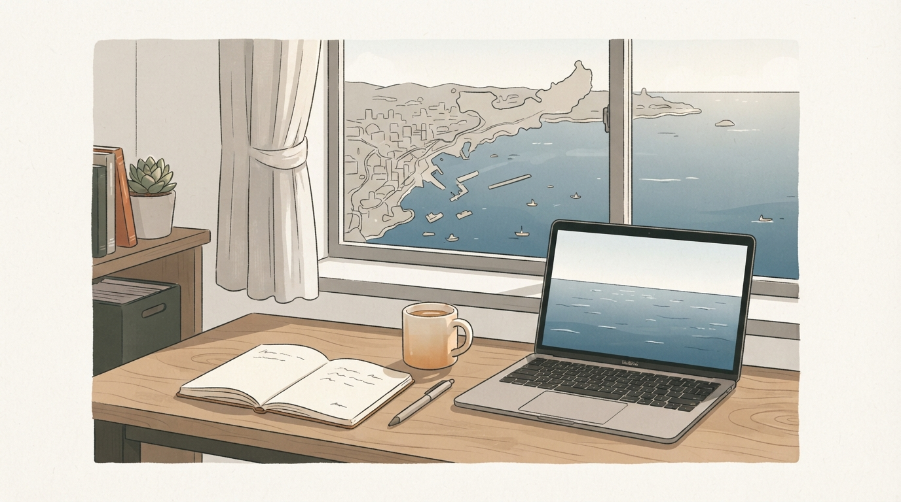
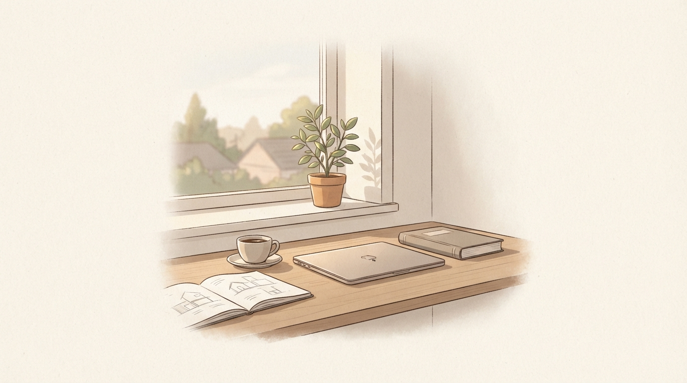
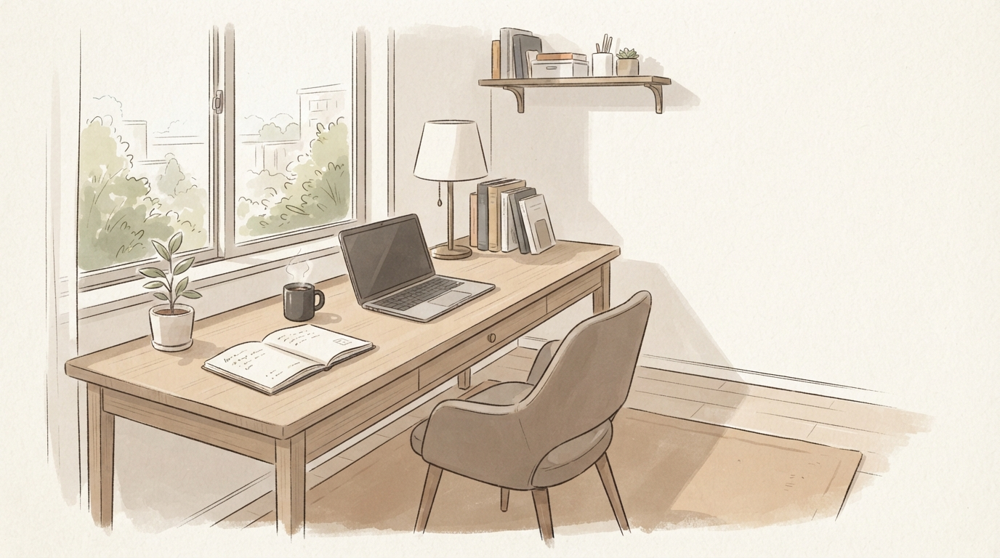

日曜日、夜9時。翌朝のアラームをセットしながら、ふと「この生活をあと何年続けるのだろうか」と考え込む瞬間はないでしょうか。

満員電車、終わらない社内調整、毎月口座から引き落とされる住宅ローンや都市部の高い家賃。真面目に働き、責任を果たしてきた50代ほど、心の中に「一度立ち止まり、自分のために暮らしてみたい」という静かな願望を抱えているものです。

その行き先として、多くの人が思い浮かべるのが「沖縄」です。青い海、温暖な気候、緩やかな時間の流れ。定年や早期退職、リモートワークの定着を機に、ひとり暮らしでの沖縄移住や数ヶ月の長期滞在を検討する方が増えています。

しかし、長年製造業で生産管理とコスト設計に携わってきた私の目から見ると、移住検討者の多くが「致命的な設計ミス」に気づかないまま飛び込もうとしているように見えます。

「沖縄は家賃が安いから、賃貸で適当なアパートを借りれば生活費は浮くはずだ」
「退職金で中古マンションや古民家を買ってリノベーションすれば、老後の住まいは安泰ではないか」

もし今、そうした甘い見通しをお持ちなら、少しだけ立ち止まって電卓を叩いてみてください。感情や憧れで決める前に、冷徹な数字と生活動線の設計に目を向ける必要があります。自由は根性ではなく、適切な「設計」で手に入れるものだからです。

今回は、50代単身者が沖縄で無理なく、持続可能に暮らすための住居戦略と、表面的な家賃比較では見えてこない「実質トータルコスト」の真実を論理的に紐解いていきます。

## 沖縄の不動産市場が突きつける冷酷な数字

まず押さえておくべき現実は、「沖縄はもはや生活費が格段に安い楽園ではない」という客観的なデータです。

かつてのイメージを引きずったまま現地の下調べを始めると、最初の数字で足元をすくわれます。

### 地価と建築費の高騰がもたらす賃料インフレ

国土交通省が発表した地価公示データ（2026年3月公表）によると、沖縄県の全用途平均地価は前年比プラス6.6％の上昇を記録しました。これは13年連続の上昇であり、東京都に次ぐ全国第2位の伸び率です。住宅地だけでもプラス6.4％上昇しており、全国平均（プラス2.1％）を大きく上回るペースで地価が高騰し続けています。

さらに、建築資材や労務単価の高騰により、居住専用建築物の坪単価は92.7万円に達しています。この影響は当然、賃貸市場にも直撃しています。

例えば、北部（名護市や今帰仁村周辺）では新テーマパーク「ジャングリア」開園に伴う従業員の住宅需要が重なり、シングル向けマンション（30平米以下）の平均家賃が5万8,477円と、わずか2年で43.1％も急騰しました。南部や那覇市近郊でも、新築分譲マンションは4,000万円台が当たり前となり、民営借家の平均家賃も5万円台中盤から6万円台へとじわじわと切り上がっています。

### 生活コストの指標が示す「東京並み」の負担

住居費だけではありません。総務省の消費者物価地域差指数（2025年結果）を見ると、沖縄県の総合指数は100.4と、すでに全国平均の100を超えています。

内訳を精査すると、さらにリアルな数字が見えてきます。

* 食料指数: 106.6（離島輸送コストや原材料高の影響で、全国トップクラスの高さ）
* 光熱・水道指数: 104.8（5月から10月過ぎまでほぼ24時間冷房を稼働させるため、電気代が跳ね上がる）
* 住居指数: 95.4（統計上は全国平均より低めに出るものの、近年の家賃急騰で急速に差が縮小中）

「沖縄に行けば月10万円で悠々自適に暮らせる」というのは、完全に過去の幻想です。東京や大阪とほぼ同等の生活コストがかかる市場で、50代の単身者がどのような住居選択をすべきか。それを考えるには、まず「購入」という選択肢のリスクを精査しなければなりません。

## 50代で「持ち家・購入」を選んではいけない3つの構造的理由

移住相談でよく耳にするのが、「毎月家賃を払い続けるのはもったいないから、中古マンションや中古戸建てを購入したい」という意見です。

しかし、50代の単身移住において、いきなり不動産を購入するのはリスクが高すぎます。製造業の設備投資と同じで、回収期間と撤退コストの観点から見ると極めて脆弱な判断と言わざるを得ません。

### 1. 住宅ローンの「返済期間の壁」

住宅金融支援機構などの規定では、住宅ローンの完済年齢は「満80歳未満」と定められています。

つまり、最長返済期間は「80歳マイナス申込時年齢」です。もし55歳で購入を決断した場合、組めるローン期間は最長でも24年〜25年に制限されます。35年ローンに比べて毎月の返済負担が大幅に重くなるうえ、60歳の定年や役職定年を迎えて収入が激減したあとも、重いローン返済が年金生活を直撃します。

厚生労働省の雇用動向調査によると、転職で賃金が増加する人の割合が減少する人を上回るのは「50〜54歳」が最後です。55歳以降は収入減のリスクが急激に高まります。退職金の大半を頭金に充てたり、年金から毎月8万〜10万円のローンを引き落とされる設計は、老後のキャッシュフローを著しく圧迫します。

### 2. 沖縄特有の「維持管理コスト」と劣化スピード

沖縄の気候は木造住宅には過酷で、住宅の約96.5％がRC（鉄筋コンクリート）造です。しかし、RC造だからといってメンテナンスフリーではありません。

年間を通じて高湿度であり、強烈な紫外線、頻繁な台風、そして海からの塩害が住宅を襲います。コンクリート内部の鉄筋が錆びて膨張し外壁が剥落する「爆裂現象」や、屋上防水の定期的な塗り替え、さらには外来種シロアリ（イエシロアリ・ダイコクシロアリ）への防除対策など、5年〜10年単位で数百万円規模の修繕費が確実に発生します。

持ち家の場合、固定資産税と修繕積立費・管理費だけで月3万〜4万円のランニングコストが固定費として積み上がります。「ローン完済後はタダで住める」という皮算用は、過酷な自然環境の前では通用しません。

### 3. 「空き家バンク」に眠る幻想と撤退可能性の喪失

「地方創生や空き家バンクで安く古民家を手に入れる」というシナリオも、沖縄では現実的ではありません。

総務省の住宅・土地統計調査によると、沖縄県の空き家率は9.4％と、埼玉県に次いで全国で2番目に低い水準です。親族間での相続関係が複雑な軍用地や借地権物件が多く、公的な空き家バンクに優良な一般物件が掲載されることはほとんどありません。

そして何より重大なのは、「暮らしが合わなかったときの撤退コスト」です。
関西学院大学の研究（前村氏らによる移住者調査）でも明らかなように、移住者の多くは「生活習慣や気候、地域関係のギャップ」に直面します。50代には本土に残した高齢の両親の介護リスクも控えています。

持ち家を抱えてしまうと、売りに出しても買い手がすぐにつかず、本土へ戻ることもできなくなる「流動性の罠」に陥ります。だからこそ、50代の沖縄暮らしは「いつでも撤退できる身軽さ（可変性）」を前提に設計しなければなりません。

## 那覇マンスリー検証：名目家賃の安さに潜む「洗濯機と食費の罠」

持ち家を排除したとき、次に検討されるのが「民間賃貸」や「マンスリーマンション」です。

特に50代の単身者がお試し移住や中期滞在を行う場合、家具家電付きのマンスリーマンションは有力な候補になります。敷金・礼金が不要で、電気・水道・Wi-Fiの開通手続きもいらないからです。

しかし、ここで多くの人が「名目上の家賃」だけを見て物件を選び、日々の暮らしで激しい後悔を味わうことになります。

### 「室内洗濯機なし」が奪う時間と金

那覇市内で格安のウィークリー・マンスリーマンションを探すと、月額7万〜8万円台の魅力的な物件がいくつか見つかります。実際に那覇の老舗長期滞在物件に滞在した方の実例を見てみましょう。

その物件は立地もよく一見快適そうに見えましたが、重大な見落としがありました。「室内に洗濯機がなく、共用のコインランドリー（有料）を利用しなければならない」という点です。

50代で健康維持のためにジムへ通い、あるいは日中汗をかいて毎日洗濯をするライフスタイルを想定してみてください。
7階の部屋から着替えを抱えて1階のランドリーまで降り、小銭を用意して投入し、40分後に取り出し、今度は乾燥機に移してさらに30分待つ。この往復動線だけで、毎日40分以上の時間と心理的エネルギーが奪われます。

費用面も無視できません。

* 洗濯（1回300円）＋ 乾燥（1回200円）＝ 1日500円
* 月間30日 ＝ 15,000円

名目家賃が8万円であっても、洗濯代だけで実質家賃は9万5,000円に跳ね上がります。しかも小銭を切らさないように崩すストレスが毎日続きます。
沖縄は湿度が高く急なスコールも多いため、部屋干しは生乾き臭の原因になり、外干しも危険です。つまり「室内洗濯機」と「ガス衣類乾燥機（または浴室乾燥）」の有無は、単なる好みの問題ではなく、毎月の出費と生活衛生を左右するコア設備なのです。

### 自炊しない単身男性の「トータルコスト方程式」

もうひとつの大きな盲点が「食費」の設計です。

ひとり暮らしの男性で、仕事や作業をしながら毎日3食きっちり自炊する人は少数派です。地元スーパー「かねひで」や「サンエー」で弁当や惣菜を買い、夜は時折外食ですませるのが現実的なルーティンになります。

この場合の支出を試算してみましょう。

* 格安マンスリー家賃: 95,000円（共益費・水光熱費込）
* 洗濯機代（コインランドリー）: 15,000円
* 朝食・昼食（弁当・コンビニ等）: 約30,000円（1日1,000円）
* 夕食・晩酌（外食・惣菜）: 約45,000円（1日1,500円）
* **実質月額支出: 約185,000円**

「家賃10万円以下で収まる」と見込んでいたはずが、トータルでは20万円近くまで膨らんでしまいます。

ここで比較対象として浮上するのが、食事付きのマンスリーレジデンス（例えば那覇市おもろまちにある「ドーミービズ」など）です。

ドーミービズのような物件は、朝夕2食（管理栄養士監修）が付き、大浴場があり、水光熱費も込みで月額約13万〜15万円前後です。名目家賃だけを見ると「月14万円は高い」と敬遠されがちですが、食費と光熱費、洗濯の手間（大浴場併設の無料ランドリーなど）をすべて同一条件で合算すると、実は外食中心の格安マンスリーと実質支出はほとんど変わりません。

毎日の献立を考える認知負荷がゼロになり、栄養バランスが保たれ、大浴場で疲れを癒せる。どちらが50代の単身者にとって生活の質を高める設計かは明白です。

目先の家賃差額2万円に目を奪われ、日々の時間と健康を削る選択をしてはいけません。コストは必ず「住居費＋食費＋水道光熱費＋家事代行費」の総和で設計するのが鉄則です。

## 賃貸でも購入でもない「第3の選択肢」：24ヶ月の段階的プロトコル

では、50代のひとり暮らし移住において、最もリスクが低く、かつ高い生活満足度を得られる最適解は何でしょうか。

それは、「いきなり定住を決めない、24ヶ月の段階的アプローチ」です。
賃貸契約という2年間の固定枠に縛られる前にも、あるいは分譲購入という不可逆な決断を下す前にも、試せる余白は十分にあります。

### ステップ1: 準備期（0〜6ヶ月）「数字の棚卸しと可視化」

感情が高ぶっているときほど、まずは紙とスプレッドシートを開いて数字を直視します。

* ねんきん定期便の確認（仮に収入が下がった場合の年金受給額をシミュレーションする）
* 現在の固定費と、移住後に削減できるコストの差額算出
* 本土に残す家族・高齢の親の健康状態と、万が一の緊急帰省ルート（那覇空港へのアクセス性）の確認

この段階で「いくらまでなら失敗しても痛手を負わないか」という許容リスク枠（損切りライン）を決めておきます。

### ステップ2: お試し期（6〜12ヶ月）「マンスリー×季節検証」

いきなり賃貸契約を結ぶのではなく、まずは1ヶ月〜2ヶ月単位でウィークリー・マンスリーを活用します。

ここで重要なのは、「最も過ごしやすい春や秋」に行くのではなく、「最も過酷な時期」をあえて選んで滞在することです。

* 6月の猛烈な湿気とカビの発生具合
* 7〜8月の容赦ない日差しとエアコン代
* 8〜9月の大型台風による停電・買い占め・交通遮断

この気候の厳しさを、ホテル滞在ではなく「スーパーで買い出しをして部屋で過ごす生活者」として体験します。このとき、前述の「室内洗濯機」「立地動線」「日々の食費」が自分の許容範囲に収まるかを検証するのです。

### ステップ3: 拠点選定期（12〜18ヶ月）「車なし都市型 or 車あり郊外型」

沖縄生活の最大の分岐点は「自家用車を持つかどうか」です。

那覇市内（おもろまち、久茂地、牧志など）であれば、ゆいレール（モノレール）と路線バス、シェアサイクル、徒歩で日常生活は完全に完結します。車の維持費（月2万〜3万円）を丸ごと浮かせることができるため、その分を駅近で設備の整った賃貸物件（Mr.KINJOの長期プランや都市型マンション）に充当するほうが、トータルの費用対効果は高くなります。

一方、中北部（読谷村や恩納村、名護市など）の自然豊かな環境を選ぶなら、車の所有は絶対条件です。運転免許の維持や将来の返納リスクも見据え、どちらが自分の性格と資金力に合っているかを冷静に見極めます。

### ステップ4: 実践期（18〜24ヶ月）「身軽な賃貸契約と『帰り道』の確保」

十分なテスト滞在を経て「暮らしていける」と確信が持てた段階で、初めて那覇市内または近郊の民間賃貸物件と契約を結びます。

50代のうちに契約を結んでおくことには大きな意味があります。65歳を超えて無職になると、民間賃貸の入居審査は格段に厳しくなるからです。一定の安定収入や社会的信用がある50代のうちに、居心地の良い長期賃貸を確保しておくのは極めて合理的な一手です。

そして最後に最も重要な設計思想をお伝えします。
それは、**「いつでも本土に戻れる帰り道を残しておくこと」**です。

親の介護が必要になった、自身の健康状態が変わった、あるいは沖縄の暮らしに満足して別の街へ行きたくなった。そのときに敷金や家具の処分だけでサッと動ける身軽さこそが、50代の単身者にとって最大のセーフティネットになります。

## まとめ：自由を手に入れるのは、根性ではなく「設計」

沖縄の青い海を眺めながら過ごす時間は、確かに素晴らしいものです。日々の激務に追われてきた方にとって、夕暮れの風を感じながら飲むオリオンビールや、地元の食堂で食べる素朴な沖縄そばは何物にも代えがたい癒やしになるでしょう。

しかし、その穏やかな日常を支えているのは、情緒的な憧れではなく、毎月の出費をコントロールし、家事動線を最適化した「冷徹な生活設計」です。

* 表面的な家賃の安さに惑わされず、食費・光熱費・洗濯コストを含めた「トータルコスト」で計算する
* 不動産購入や長期ローンに手を出さず、撤退可能な可変性を維持する
* 段階的なお試し滞在を通じて、過酷な季節の現実を肌で知る

これらを一つずつクリアしていけば、沖縄移住は決してギャンブルではなく、人生の後半戦を豊かに彩る再現性の高いプロジェクトになります。

明日からの毎日に少し疲れたら、まずはノートを開いてみてください。
あなたが本当に手に入れたい暮らしと、それを実現するために必要な数字の設計図を、静かに描き始めることからすべては始まります。